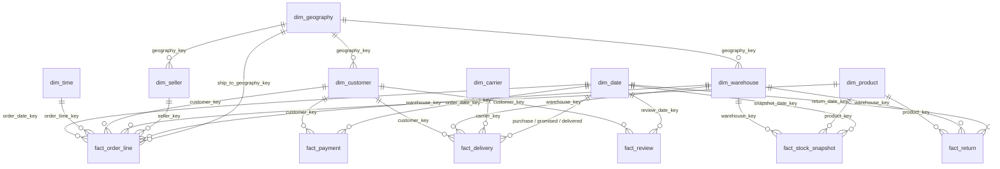

# Data model (owner: DE2)

**Source of truth:** `contracts/` (one YAML per table) and `sql/`. This page explains them.
**Checks:** `tests/contracts/` verifies every contract against the rules below.

## Layers and storage

| Layer | Fabric item | Tables | Load style |
|---|---|---|---|
| Source (OLTP) | SQL database `sqldb_shop` | `shop.*` (SAP-style), `wb.*` (write-back, temporal) | Generator inserts; Fabric App writes `wb.*` |
| Bronze | Lakehouse `lh_bronze` | `shop_*` and `wb_*` (shortcuts to the SQL DB mirror), `wms_event`, `carrier_event` (Eventstream), `ref_*` (pipeline) | Raw, append-only by convention; mirrors are read-only |
| Silver | Lakehouse `lh_silver` | Typed, deduplicated, conformed, pseudonymised, LLM-enriched reviews; plus `ops.run_log` | MERGE on business key, idempotent |
| Gold | Lakehouse `lh_gold` | Kimball star schema: 8 dimensions, 6 facts | MERGE (SCD2 for customer and product) |

## Gold star schema



| Table | Type | Grain | SCD |
|---|---|---|---|
| `fact_order_line` | Transaction | One order item | — |
| `fact_payment` | Transaction | One payment line of an order | — |
| `fact_delivery` | Accumulating snapshot | One order. Milestones (approve, pick, pack, ship, deliver) fill in as events arrive; OTIF flags | — |
| `fact_stock_snapshot` | Periodic snapshot | Day × warehouse × product | — |
| `fact_review` | Transaction | One review per order. Score, sentiment, topic; no free text | — |
| `fact_return` | Transaction | One return receipt at a warehouse | — |
| `dim_customer` | Dimension | One version per pseudonymised person | **2** |
| `dim_product` | Dimension | One version per product | **2** |
| `dim_seller`, `dim_warehouse`, `dim_carrier`, `dim_geography` | Dimension | One row per business key | 1 |
| `dim_date`, `dim_time` | Dimension | Day 2016–2030; minute of day | — |

**KPIs and where they come from (SPEC §3):**

| KPI | Source |
|---|---|
| OTIF, delivery days, pick-to-ship hours | `fact_delivery` |
| Return rate | `fact_return` ÷ `fact_order_line` |
| Stock coverage days | `fact_stock_snapshot.on_hand_qty` ÷ average daily `issues_qty` |
| Sentiment | `fact_review` |
| GMV net and gross | `fact_order_line` |

## Key strategy

- **Business keys** come from the source (`order_id`, `product_id`, …). Every contract lists them under `business_key`.
- **Surrogate keys** in Gold are `bigint` values from `xxhash64(business key)`. SCD2 dimensions use `xxhash64(business key, valid_from)`.
  - The keys are deterministic: re-running a load gives the same keys, so loads are idempotent and there are no sequence generators.
  - Only Gold has surrogate keys. Silver keeps business keys.
- **Unknown member `-1`** exists in every dimension (`unknown_member: true`).
  - A fact row whose lookup fails gets `-1`, never NULL. For example, `carrier_key` stays `-1` until the parcel is handed over.
  - Date keys are `yyyymmdd` integers, and `-1` means not yet happened.
- **SCD2 columns:** `valid_from`, `valid_to` (`9999-12-31` for the current row), `is_current`, `row_hash`.
  - The load compares `row_hash`, then closes the old row and inserts the new one in one MERGE.
  - Facts join to the version valid at the event time (`purchase_ts`).
- **Constraints:**
  - Delta enforces `NOT NULL` and `CHECK` (the `constraints` section of each contract).
  - Delta does not enforce PK and FK. Contract tests check uniqueness and integrity on the deployed tables.
  - The SQL DB enforces PK, FK and CHECK natively.

## Time travel and retention (F2 rules, SPEC §4)

| Where | Setting | Effect |
|---|---|---|
| Delta (Bronze, Silver, Gold) | `delta.logRetentionDuration = 7 days`, `delta.deletedFileRetentionDuration = 2 days` | Time travel works for at least 2 days after a `VACUUM`, up to 7 days of history |
| Silver and Gold | `delta.enableChangeDataFeed = true` | Incremental loads read only what changed |
| SQL DB `wb.*` | System-versioned temporal tables | Full history of every write-back, kept forever |
| Bronze shortcuts | Managed by mirroring | History lives in the source |

```sql
-- what did a Gold table look like before last night's load?
DESCRIBE HISTORY lh_gold.fact_delivery;
SELECT * FROM lh_gold.fact_delivery VERSION AS OF 12;
SELECT * FROM lh_gold.fact_delivery TIMESTAMP AS OF '2026-11-23 06:00:00';
-- undo a bad load
RESTORE TABLE lh_gold.fact_delivery TO VERSION AS OF 12;
```

```sql
-- who changed a reorder policy, and when (SQL DB)
SELECT * FROM wb.reorder_policy FOR SYSTEM_TIME ALL WHERE material_id = '...' ORDER BY valid_from;
```

## GDPR

- **Pseudonymisation:** `customer_unique_id` (the real person) is replaced in Silver by `customer_pseudo_id = sha2(customer_unique_id + salt)`. The salt is a secret, never stored in a table.
- **Tagging:** columns marked `pii: true` exist only in Bronze and Silver. A test fails if one reaches Gold.
- **Review text** (`comment_en`) stays in Silver. Gold keeps score, sentiment and topic only.
- **RLS:** `dim_customer.region_code` carries the Bundesland, which the semantic model uses for row-level security.
- **Deletion request:**
  1. Delete the person in the SQL DB. Mirroring removes them from Bronze.
  2. MERGE-delete in Silver and Gold.
  3. `VACUUM` after the 2-day retention, so time travel can no longer show them.

## Errors and quarantine (pattern for DE1 loads)

- **Quarantine tables:** rows failing a contract check go to `<layer>._quarantine_<table>`, with the same columns plus `_reason string` and `_run_id string`.
- **Run log:** every run writes one row per target table to `ops.run_log` (contract `contracts/ops/run_log.yml`).

## Changing a contract

1. Open a PR from a `de2/` branch (DS may propose `pred_*` and `rec_*` contracts).
2. Bump the version:
   - **Minor** for added nullable columns.
   - **Major** for renames, type changes, key changes or removed columns. Add a migration note in the PR.
3. The DE Manager approves. DE1 updates the loads in a follow-up issue.
4. DDL notebooks (`nb_ddl_*`) are idempotent (`CREATE TABLE IF NOT EXISTS` + `ALTER TABLE ADD COLUMNS`). CD runs them after every deploy.
